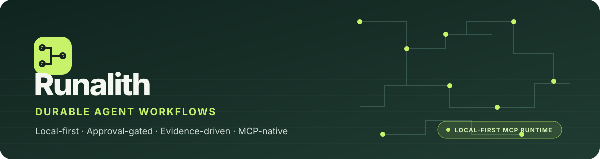
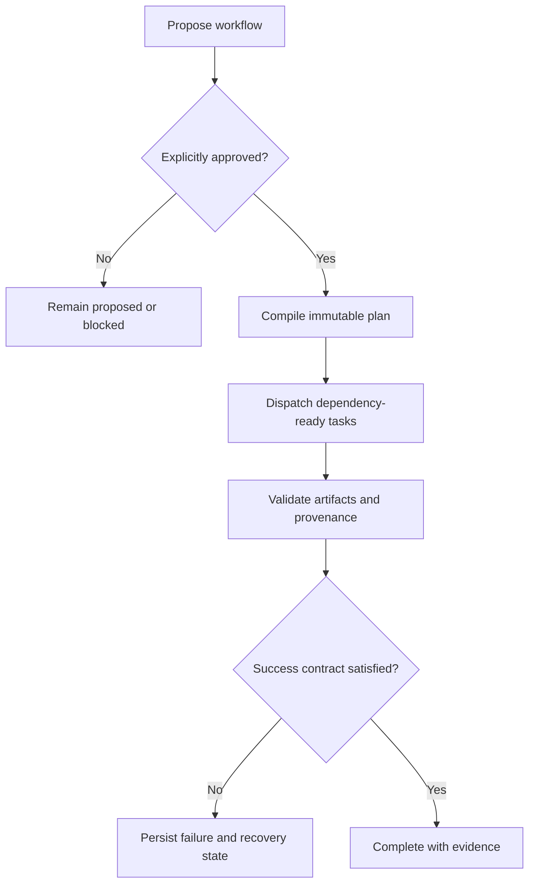

<p align="center">
  
</p>

<p align="center">
  <a href="https://github.com/nplongx/runalith/actions/workflows/ci.yml"></a>
  <a href="https://github.com/nplongx/runalith/actions/workflows/pages.yml"></a>
  <a href="https://github.com/nplongx/runalith/releases"></a>
  <a href="LICENSE"></a>
  <a href="https://nodejs.org/"></a>
</p>

<p align="center">
  <a href="https://nplongx.github.io/runalith/">Website</a> ·
  <a href="https://github.com/nplongx/runalith/releases">Releases</a> ·
  <a href="docs/README.md">Docs</a> ·
  <a href="CONTRIBUTING.md">Contribute</a> ·
  <a href="SECURITY.md">Security</a>
</p>

> [!WARNING]
> **Testing pre-release — not production-certified.** The strict Phase 2 readiness gate remains `BLOCKED_NOT_READY` (`execution_permitted=false`). Read the [latest release notes](https://github.com/nplongx/runalith/releases/tag/v1.0.9-rc.5) and [release policy](docs/RELEASE_POLICY.md) before evaluating or installing a candidate.

Runalith turns multi-step agent work into an explicit, inspectable workflow: approved immutable plans, dependency-aware tasks, typed evidence, durable SQLite state, bounded local execution, and recovery records.

Runalith is a runtime, not a hosted model or remote execution service. Reasoning is supplied by the MCP client/assistant; supported deterministic commands run locally under a plan-bound contract. The installable `.mcpb` is a standard bundle container for compatible clients, not a proprietary Runalith-only format.

## Contents

- [Why Runalith](#why-runalith)
- [Capabilities](#capabilities)
- [Workflow lifecycle](#workflow-lifecycle)
- [Quick start](#quick-start)
- [Connect an MCP client](#connect-an-mcp-client-directly)
- [How a workflow runs](#how-a-workflow-runs)
- [Documentation](#documentation)
- [Development commands](#development-commands)
- [Security and project status](#security-and-project-status)

## Why Runalith

Agent reasoning can be flexible; execution should still be reviewable. Runalith separates the assistant's reasoning from the runtime's persisted plans, approvals, task execution, and evidence checks.

| Principle | Runtime behavior |
|---|---|
| **Approval before execution** | A proposal is not authorization. Dispatch requires an explicitly approved, immutable plan. |
| **Durability by default** | Workflow state, task transitions, artifacts, and audit events are persisted in SQLite for inspection and recovery. |
| **Evidence over assertion** | Completion gates examine supported success predicates, artifact schemas, hashes, and producer lineage—not narrative claims alone. |
| **Local-first boundaries** | The stdio MCP server does not open an HTTP listener; deterministic local commands run under plan-bound contracts. |

## Capabilities

- **Dependency-aware orchestration:** tasks become eligible only when planned dependencies and required evidence are satisfied.
- **Reusable workflow policy:** versioned policy packs can pin supported constraints and success predicates before approval.
- **Local observability:** an optional loopback-only dashboard provides read-only inspection of workflow state.
- **MCP-native integration:** connect compatible clients over stdio or install the `.mcpb` bundle in a client that supports it.

## Workflow lifecycle



The `workflow_coordinator_step` API can drive much of this lifecycle one high-level step at a time, but it does not bypass approval or replace the client assistant's reasoning. See the [workflow lifecycle and recovery guide](docs/workflow-lifecycle.md).

## Quick start

### Requirements

- Node.js **22.13 or newer** and npm.
- `tmux` only when exercising deterministic local execution tasks.
- An MCP-compatible client for stdio integration. Clients that support MCPB can install the `.mcpb` bundle using their own installation flow.

### Check out and test

```bash
git clone https://github.com/nplongx/runalith.git
cd runalith
npm ci
npm test
```

### Build an MCP bundle

```bash
npm run pack:runalith-mcpb
```

The packer creates a uniquely named candidate under `dist/`, validates the archive, smoke-tests the extracted MCP runtime, checks tool schemas, and runs the local acceptance suite. Use the exact path and SHA-256 printed by the command. A candidate is not automatically a release or production approval.

### Connect an MCP client directly

A client that supports stdio MCP can launch the source entrypoint directly. Configure its MCP server entry with the absolute path to `server/index.js`, for example:

```json
{
  "mcpServers": {
    "runalith": {
      "command": "node",
      "args": ["/absolute/path/to/runalith/server/index.js"],
      "env": {
        "RUNALITH_DATA_DIR": "/absolute/path/to/private/runalith-data",
        "RUNALITH_WORKSPACE": "/absolute/path/to/workspace"
      }
    }
  }
}
```

The exact configuration syntax varies by client. Keep the data directory private and choose a dedicated workspace. The MCP entrypoint uses newline-delimited JSON-RPC on stdin/stdout and does not open an HTTP listener.

## How a workflow runs

1. **Propose:** `workflow_create` records a proposal without authorizing execution.
2. **Review and approve:** inspect the proposal, then call `workflow_approve` to authorize and compile its immutable plan.
3. **Dispatch and execute:** `workflow_dispatch` starts the approved workflow. Tasks are released in dependency order; deterministic commands must come from plan-bound execution contracts.
4. **Inspect and recover:** use workflow, event, artifact and diagnosis tools to inspect durable state. Failed or incomplete work remains failed or blocked until it is actually resolved.
5. **Synthesize:** `workflow_complete_synthesis` applies reviewer, artifact, provenance and success-contract gates before terminalizing the workflow.

See the [documentation index](docs/README.md) for architecture, tool schemas, policies, and operational guides.

## Documentation

| I want to… | Read |
|---|---|
| Build, connect and verify the MCP runtime | [Quickstart](docs/quickstart.md) |
| Understand approval, execution, recovery and synthesis | [Workflow lifecycle and recovery](docs/workflow-lifecycle.md) |
| Understand runtime and trust boundaries | [Architecture](docs/architecture.md) |
| Understand deterministic batch execution | [Durable batch execution](docs/batch-execution.md) |
| Look up MCP tool inputs and schemas | [MCP tool reference](docs/MCP_REFERENCE.md) |
| Understand names and compatibility identifiers | [Terminology guide](docs/TERMINOLOGY.md) |
| Use custom roles and Agent Skills | [Agent Skills](docs/agent-skills.md) |
| Combine specialist reasoning with deterministic execution | [Hybrid engineering workflow](docs/hybrid-engineering-workflow.md) |
| Define and attach reusable workflow policies | [Workflow policies](docs/workflow-policies.md) |
| Run the read-only local dashboard | [Dashboard guide](docs/local-dashboard.md) |
| Contribute code or documentation | [Contributing](CONTRIBUTING.md) and [documentation workflow](docs/DOCUMENTATION_WORKFLOW.md) |
| Understand known issues and release limits | [Known issues](docs/KNOWN_ISSUES.md) |
| Read the testing-vs-production release standard | [Release policy](docs/RELEASE_POLICY.md) |

## Development commands

| Command | Purpose |
|---|---|
| `npm start` | Start the MCP stdio server for local development. |
| `npm test` | Run the local acceptance and regression suite. |
| `npm run test:protocol` | Test the structured execution protocol. |
| `npm run test:workflow-m4` | Test workflow-plan, role-input, artifact and orchestrator contracts. |
| `npm run dashboard` | Start the optional read-only dashboard, normally at `http://127.0.0.1:8318`. |
| `npm run test:dashboard` | Run dashboard integration and security regression tests. |
| `npm run pack:runalith-mcpb` | Build and verify a local MCPB candidate. |
| `npm run docs:check` | Check local Markdown links and documentation constraints. |

## Security and project status

Runalith is designed for controlled local development and testing; it is **not certified for production use**. Structured execution and filesystem checks are defense-in-depth, not an operating-system sandbox. The dashboard is a loopback-only read-only view, not an authenticated remote admin service, and output redaction cannot guarantee that every secret is detected.

Published packages are experimental testing candidates, not production certifications. Use the [Releases page](https://github.com/nplongx/runalith/releases) for available packages, verify the checksum, and read the corresponding notes before installation. Formal production/frozen-release gates remain separate from the minimum standard for a testing pre-release; see [release policy](docs/RELEASE_POLICY.md) and [known issues](docs/KNOWN_ISSUES.md).

Runalith is distributed under the [MIT license](LICENSE). Security issues should follow [SECURITY.md](SECURITY.md).
