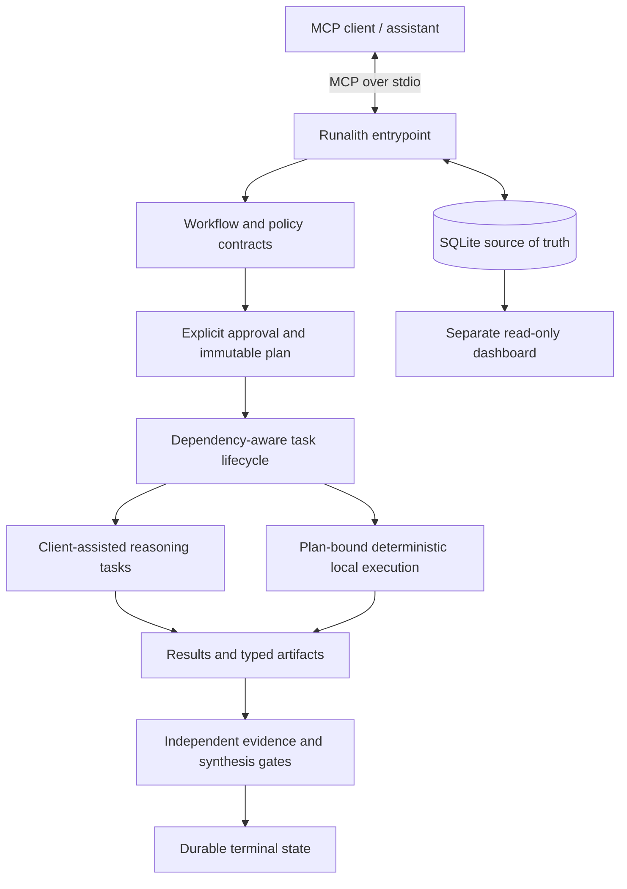

# Architecture

Runalith is a local-first MCP workflow runtime. It exposes tools over stdio, persists workflow state in SQLite, enforces explicit approvals and immutable task plans, and validates durable evidence before a workflow can finish successfully. It is not a hosted model service or remote execution fleet.

## Runtime overview

The exact reasoning experience depends on the connected client. The diagram describes the runtime boundary, not a claim that every MCP client implements all optional role-handoff conveniences. The dashboard reads the existing database and does not participate in workflow decisions or mutations. The [architecture illustrations](diagrams/README.md) provide supplementary views.

## Trust and state boundaries

### MCP entrypoint

The shipped entrypoint is `server/index.js`. It uses newline-delimited JSON-RPC over stdin/stdout and does not open an HTTP listener. Diagnostic output belongs on stderr so it does not corrupt the MCP transport.

### Proposal, approval and plan

`workflow_create` records a proposal. It does not authorize execution. Explicit approval compiles an immutable plan whose task IDs, dependencies, role contracts, supported success predicates, and pinned policy/role snapshots constrain later execution. Changing the intended topology or pinned snapshots requires a new proposal rather than in-place edits to an approved plan.

### Durable store

SQLite is the source of truth for workflow state, tasks, approvals, results, artifacts, execution records and audit events. A UI projection or model-generated narrative does not replace these records. Integrity hashes detect content mismatch; they are not proof that content is correct or that a local database is tamper-proof against unrestricted filesystem access.

### Reasoning and deterministic execution

Reasoning tasks are handled by the connected assistant/client using role-specific instructions and input evidence. Deterministic local commands are available only through a plan-bound execution contract. Callers cannot turn a reasoning task into an arbitrary shell command by supplying executable details to an execution tool. Execution results and task artifacts are persisted and checked against the planned contract.

### Completion gates

Completion is not a free-form model decision. The runtime checks task state, typed artifact validity, successful producer lineage, reviewer/QA requirements, and declared success predicates where applicable. The success assessment supplied at synthesis is evidence for evaluation, not authority to override it. Missing or mismatched evidence leaves the workflow blocked or failed.

### Dashboard

The optional dashboard is a separate loopback-only process. It opens the workflow database read-only and offers inspection, not approval, dispatch, retry, or mutation. Loopback binding reduces network exposure but is not user authentication; it is not a remote admin console.

## Recovery model

Recovery reconciles durable intent and result records with actual task/execution state. Stale work may be diagnosed, retried through an authorized recovery path, or left blocked. A retry must preserve the immutable plan and relevant provenance. Recovery must not fabricate a successful result, erase historical evidence, or infer exactly-once external side effects from local task completion.

## Scope and non-goals

- The shipped runtime is local-first; its MCP entrypoint does not dispatch to a cloud worker or remote runner.
- The dashboard is a local read-only observer, not a second workflow engine.
- Structured execution and workspace checks are defense-in-depth, not an OS/container sandbox.
- Passing tests does not by itself establish production readiness, autonomous specialist quality, live integration, or exactly-once external delivery.
- Experimental distributed-worker and integration work elsewhere in the repository is separate unless the shipped entrypoint and tests prove it is enabled here.

## Implementation starting points

| Concern | Starting point |
|---|---|
| MCP tool surface | `server/index.js` |
| Runtime lifecycle and persistence | `src/runtime/` |
| Workflow contracts and artifact schemas | `src/runtime/workflow/` |
| Structured execution protocol | `protocol/` |
| MCPB packaging | `scripts/package-runalith-mcpb.sh` |
| Regression and acceptance evidence | `tests/` |

Use the [documentation index](README.md) for user guides and [known issues](KNOWN_ISSUES.md) for current limitations and release blockers.
