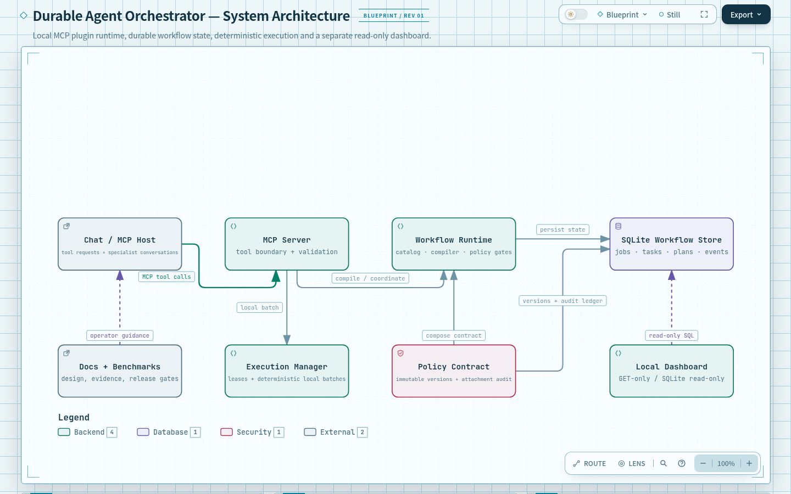
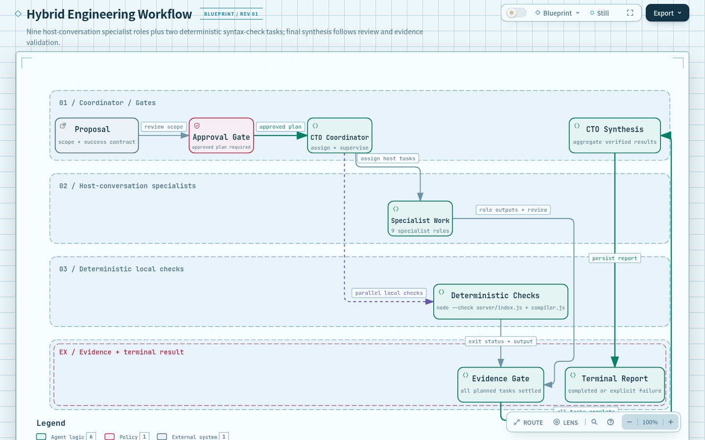
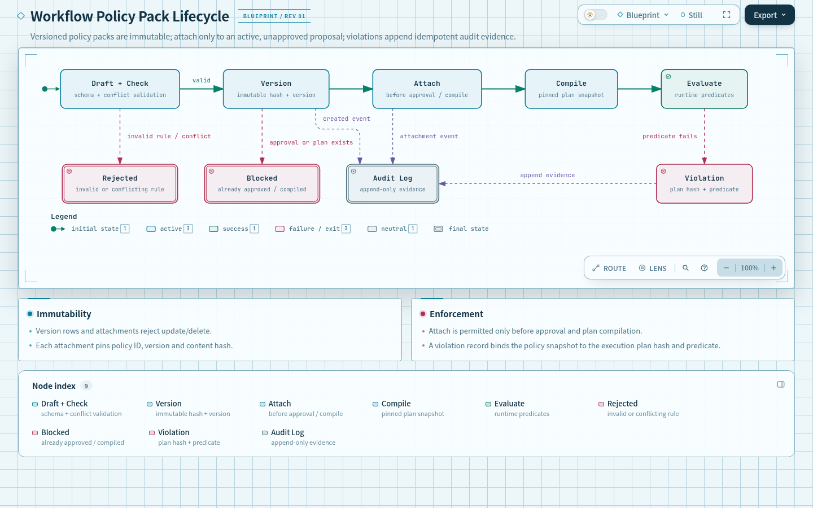
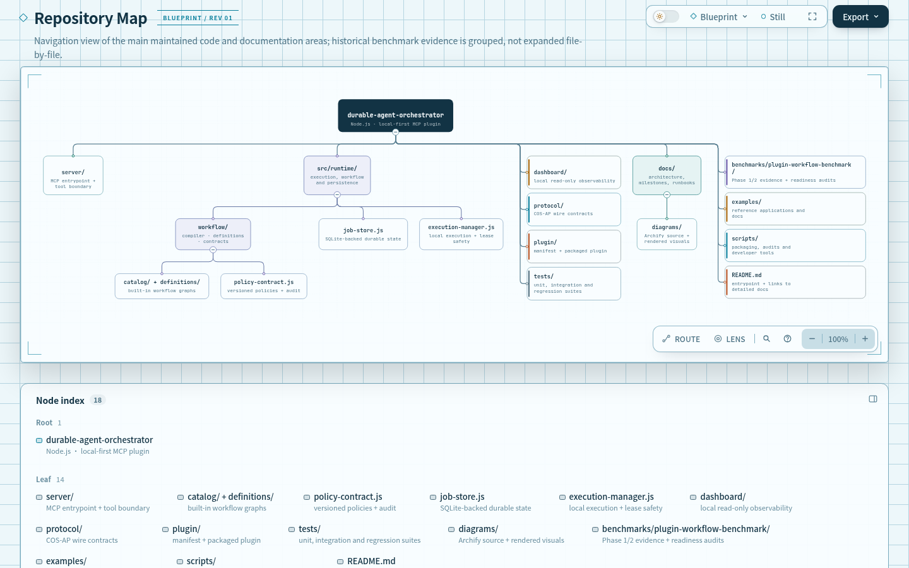

# Architecture illustrations

These static illustrations supplement the written documentation. They are not interactive on GitHub, and they are not a substitute for the component explanations, source code, tests, or formal release evidence.

## System architecture

The view shows the local MCP entrypoint, durable SQLite state, workflow coordination, deterministic execution, policy/evidence checks, and the separate read-only dashboard.

Read the [architecture explanation](../architecture.md) for the trust boundaries and recovery behavior.

## Hybrid engineering workflow

The view summarizes proposal and approval gates, specialist reasoning, deterministic local checks, evidence validation, and synthesis.

Read the [hybrid workflow guide](../hybrid-engineering-workflow.md) for the actual dependency contract and usage boundaries.

## Versioned workflow policy lifecycle

The view summarizes validation, immutable versions, pre-approval attachment, runtime evaluation, and audit events.

Read the [workflow policy reference](../workflow-policies.md) for supported predicates and enforcement behavior.

## Repository map

The view groups the main runtime, interface, tests, documentation, examples, and engineering-record areas.

## Maintenance notes

The underlying diagram definitions and optional render helper are kept under [`source/`](source/) and [`scripts/`](../../scripts/). Use them only when changing a diagram is useful to readers; generated HTML and transient validation receipts are not part of the GitHub documentation experience.
