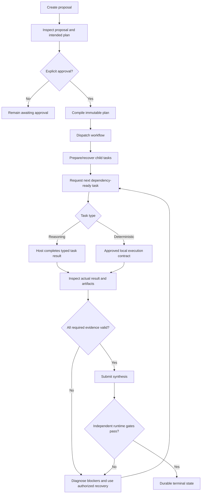

# Workflow lifecycle and recovery

This guide explains the supported lifecycle of a local workflow: create a proposal, inspect it, explicitly approve it, dispatch it, complete dependency-ready tasks, and terminalize only after the runtime accepts the required evidence. For exact tool inputs and JSON schemas, use the [MCP tool reference](MCP_REFERENCE.md).

## Lifecycle at a glance



## 1. Create and inspect a proposal

Call `workflow_catalog` to discover available built-in workflow templates. Then create a proposal with `workflow_create`. The minimum shape is `title` and `task`; `workflow`, `workspace`, supported `role_bindings`, `goal`, `constraints`, and `success_criteria` are optional inputs defined in the live tool schema.

Example request body:

```json
{
  "title": "Improve documentation navigation",
  "task": "Add a source-verified guide and regression checks.",
  "workflow": "standard-engineering",
  "workspace": "/path/to/a/disposable/local/checkout"
}
```

The workspace is an example path: choose a real local checkout appropriate to the intended operation. Before approving, inspect the returned proposal and intended task plan. If using custom role overlays, create/import the roles first and bind exact existing role versions; IDs in examples are not automatically created records. See [Agent Skills](agent-skills.md).

Creating a proposal does **not** approve, dispatch, or execute it.

## 2. Approve explicitly, then dispatch

Call `workflow_approve` with the exact `job_id` and a meaningful `confirmation` string after you have inspected and accepted the proposal. Approval compiles the immutable plan and pins the relevant task contracts and snapshots. The approved plan should not be modified in place; changed goals or task topology require a new proposal.

After approval, call `workflow_dispatch` with the `job_id` to start the workflow. This local entrypoint does not dispatch to a cloud worker or create remote worker processes. `workflow_prepare_tasks` creates or recovers the planned child tasks and is safe to repeat.

## 3. Complete tasks in dependency order

Call `workflow_next_task` to obtain the next dependency-ready task, role-specific contract, and eligible predecessor evidence. Do not skip a blocked dependency or invent a result for a task that has not been issued.

- **Reasoning/specialist task:** complete the requested work, then call `workflow_complete_task` with the exact `task_id`, the actual result `content`, and the typed `artifact`. A failed task can be recorded with `outcome: "failed"`; do not turn missing evidence into a success result.
- **Deterministic local task:** use `task_execute_local` for a single plan-bound command or `execute_batch` for a set of eligible, prepared tasks in the same approved workflow. Callers do not supply arbitrary command/executable/working-directory details. See [Durable batch execution](batch-execution.md).
- **High-level coordinator path:** `workflow_coordinator_step` can advance an already-approved workflow, execute only authorized deterministic local steps, and return the next specialist task or synthesis contract. It never approves a proposal or bypasses runtime evidence gates.

After recording a task result, request the next task again. The scheduler is responsible for dependency readiness; a task's declared input/evidence contract must be satisfied by actual eligible predecessor results.

## 4. Inspect progress and diagnose blockers

Use the following read-oriented tools when investigating state:

| Tool | Use |
|---|---|
| `workflow_get` | Inspect workflow state, immutable plan, task states, artifact metadata, and current phase. |
| `workflow_events` | Read durable workflow event history and observability details. |
| `workflow_artifacts` | Inspect durable artifacts and their active/superseded status. |
| `workflow_diagnose` | Identify failed/pending tasks, reviewer findings, stale or missing artifacts, and safe next actions; it does not mutate state. |
| `workflow_recovery_verify` | Verify persisted workflow invariants and read the same SQLite state from a fresh Node process; this does not prove supervisor restart or all runtime behavior. |

If work is blocked, investigate the durable state and the exact failed contract first. Do not call completion tools repeatedly with modified claims in an attempt to force a pass.

### Authorized rework paths

- `workflow_request_rework` is a scoped, provenance-preserving specialist rework path for the supported `standard-engineering` v2 review flow after a completed reviewer decision. It invalidates affected active artifacts and creates linked role-revision tasks; it does not change the approved plan hash, approve synthesis, or mark work completed.
- `workflow_request_reviewer_revision` is narrower: it is only for a `standard-engineering` v2 review that was accepted but blocked solely by a documented non-empty `evidenceIssues` list. It is not a way to revise a rejected review or clear implementation/security findings.
- A failed deterministic execution is not silently rerun by these rework tools. Diagnose the actual execution state and follow the specific recovery contract.

If the request or intended plan must change, create a new proposal and obtain approval for that proposal instead of editing the existing immutable plan.

## 5. Synthesis and successful terminalization

When the required specialist work and review/QA evidence are ready, obtain and follow the synthesis contract returned by the coordinator or task lifecycle. Submit the real synthesis through `workflow_complete_synthesis` or the corresponding `synthesis` input accepted by `workflow_coordinator_step`.

The runtime checks the durable task state, typed artifact schema/hash and producer lineage, workflow-specific reviewer/QA requirements, and any declared closed JSON success predicates. If the plan declares `constraints` or `success_criteria`, the synthesis artifact must contain a `success_assessment` whose rows identify those exact IDs, claim the required status, and cite the exact active artifact IDs for artifact-based predicates. The runtime independently evaluates the facts; an assertion in the synthesis text cannot override a failed gate.

If the gate fails, the workflow remains uncompleted/blocked or fails according to the actual runtime state. Do not describe a proposed action, an accepted narrative, a valid content hash, a build, or a test run as proof that every workflow goal was achieved.

## Common mistakes

- **Treating proposal creation as approval:** `workflow_create` only records the proposal. Review it, then explicitly call `workflow_approve`.
- **Dispatching before approval:** `workflow_dispatch` is for an already approved workflow.
- **Calling `workflow_complete_task` for deterministic work:** that API records reasoning-task results; deterministic tasks must follow their stored execution contract.
- **Using a tool schema as an authorization grant:** the schema describes valid input shape; runtime task state, immutable plan, approval, permissions and evidence gates still decide whether the operation is permitted.
- **Assuming dashboard labels or hashes prove compliance:** the dashboard is read-only, and snapshot integrity is not the same as current policy compliance.
- **Confusing local evidence with production readiness:** unit/E2E tests do not by themselves certify autonomous worker quality, live external integration, exactly-once external side effects, or an authorized release.

## Related guides

- [MCP tool reference](MCP_REFERENCE.md)
- [Workflow policy packs](workflow-policies.md)
- [Hybrid engineering workflow](hybrid-engineering-workflow.md)
- [Durable batch execution](batch-execution.md)
- [Architecture](architecture.md)
- [Known issues and release blockers](KNOWN_ISSUES.md)
